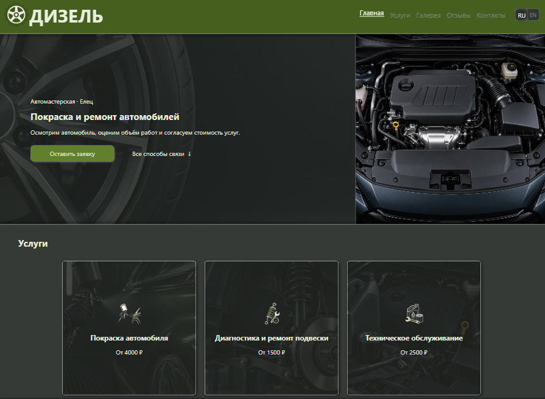
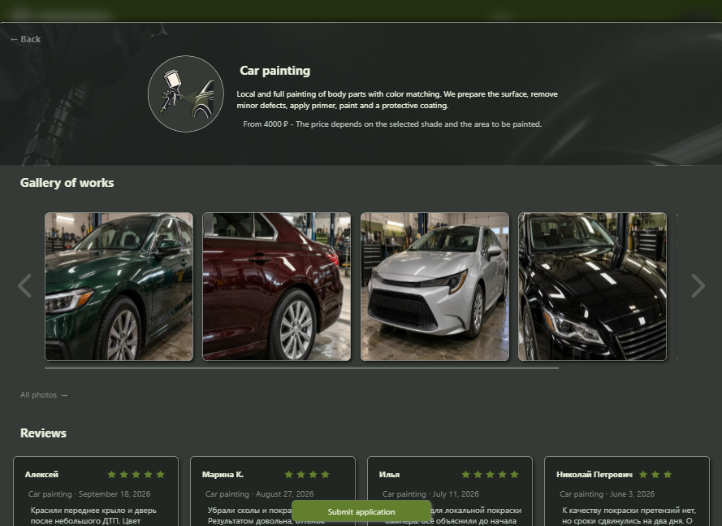
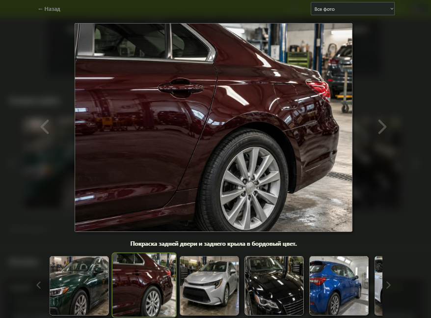
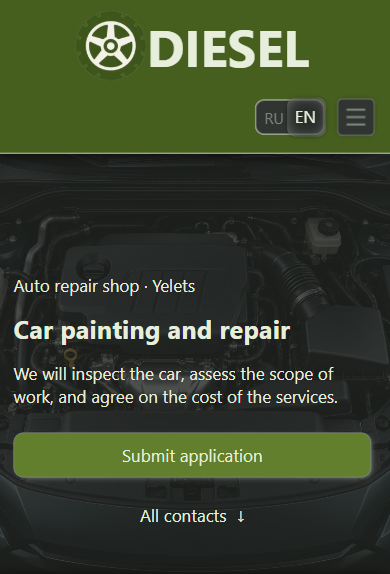

# Diesel Auto Workshop

Diesel is a responsive bilingual website for a fictional auto repair workshop. It was created as a final project for a TypeScript learning module and demonstrates how a moderately sized browser application can be organized without a frontend framework.

> **Demo project:** the contact details, reviews, service prices, gallery content, and consultation submission are provided for demonstration purposes only. No request is sent to a real business or backend.

## Features

- Russian and English interface with instant language switching
- Responsive, mobile-first layout
- Service cards with detailed information, pricing, related photos, and reviews
- Filterable work gallery with an expanded image viewer
- General and service-specific customer reviews
- Contact section with copy-to-clipboard actions and external contact links
- Animated modal sections with navigation history
- Consultation form with custom validation and field-level error messages
- Draft persistence using `localStorage` and `sessionStorage`
- Simulated asynchronous submission with success, field-error, and global-error responses

## Screenshots

### Desktop overview



### Service details



### Work gallery



### Mobile overview



## Technical Highlights

- Strict TypeScript with interfaces, generics, type guards, mapped types, and literal unions
- Feature-oriented modular structure with explicit public contracts between modules
- A composition root that connects independent UI and data modules
- JSON-based service data, localization content, gallery metadata, reviews, and contacts
- Reusable gallery and review views for both the main page and service details
- Native browser APIs, including `<dialog>`, Web Storage, Clipboard, and DOM APIs
- Responsive images in WebP format and Lucide icons installed as a project dependency
- Production build and development server powered by Vite

## Project Structure

```text
src/
├── App/               # Application composition and module contracts
├── ApplicationForm/   # Consultation form, validation, and draft persistence
├── Contacts/          # Contact information and clipboard actions
├── Detailed/          # Detailed service presentation
├── Dialog/            # Modal sections, transitions, and navigation history
├── Gallery/           # Gallery data and reusable gallery views
├── Navigation/        # Page navigation and active-section handling
├── Notifyer/          # User notifications
├── Page/              # Main page layout and presentation logic
├── Reviews/           # Review data and reusable review views
├── Services/          # Service data and service cards
├── api.ts             # Simulated asynchronous API
├── languages.ts       # Shared localization types and utilities
└── main.ts            # Composition root and application startup
```

## Running Locally

Install the dependencies:

```bash
npm install
```

Start the development server:

```bash
npm run dev
```

Create a production build:

```bash
npm run build
```

Preview the production build locally:

```bash
npm run preview
```
## Simulated API Scenarios

The consultation form uses a simulated asynchronous API with a four-second response delay. Fill in all required fields with otherwise valid values, then use the following inputs to test different responses:

| Input | Simulated response |
| --- | --- |
| Any regular valid data | Successful submission |
| Date: `2101-12-10` | Server-side error associated with the date field |
| Time: `12:30` | Server-side error associated with the time field |
| Brief problem description: `Global error` | Global server error not associated with a particular field |

The date and time values can be used together to display multiple field-level errors. Test `Global error` separately.

## Implementation Note

The application architecture, TypeScript code, HTML structure, and CSS were written manually as part of the learning process. No frontend framework or generated application code was used. AI-assisted tools were used only to help produce some visual assets and repetitive fictional demo content.

## Technology Stack

- TypeScript
- HTML and CSS
- Vite
- Lucide icons
- Native browser APIs

## Status

The project is complete as a TypeScript portfolio and learning project. A real production version would require a backend, genuine business data, server-side validation, real request processing, and additional deployment and SEO work.

## Live Demo

[View the live project](https://dahulf.github.io/diesel-auto-workshop/)
